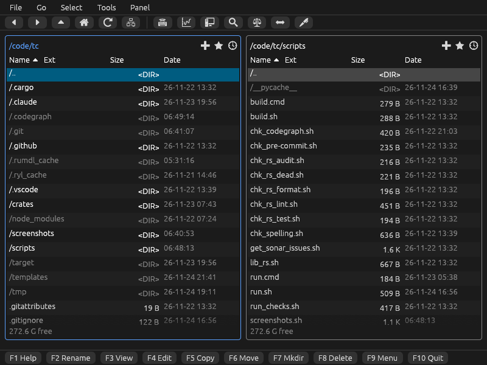
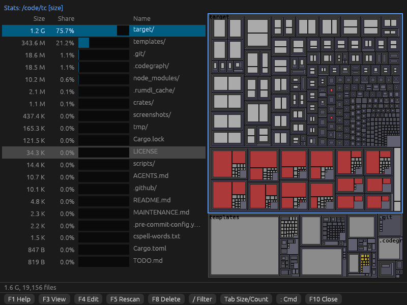
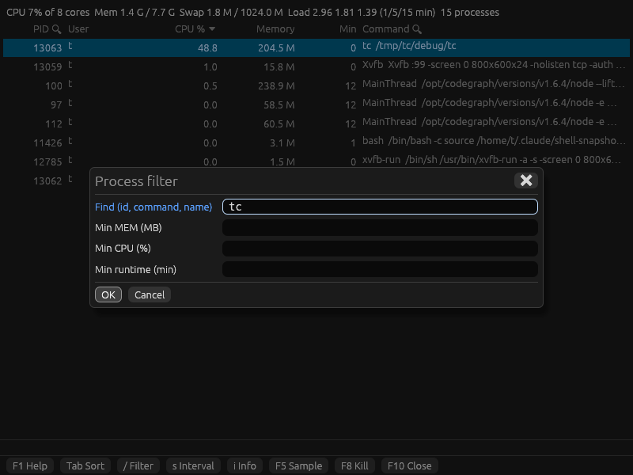
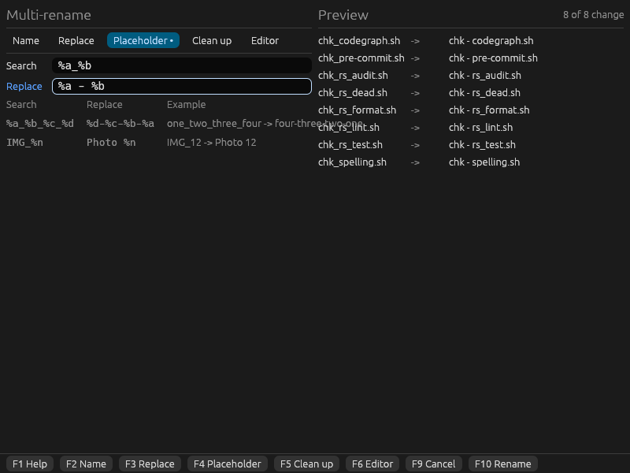
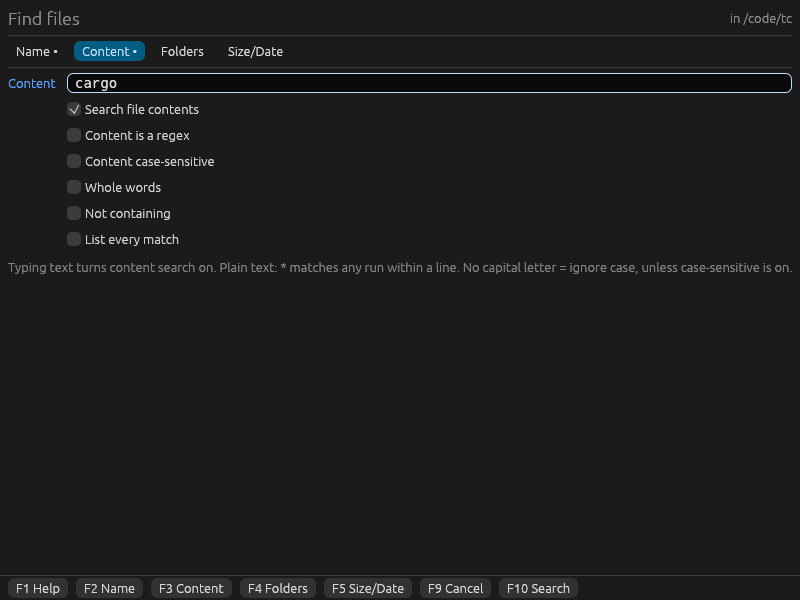
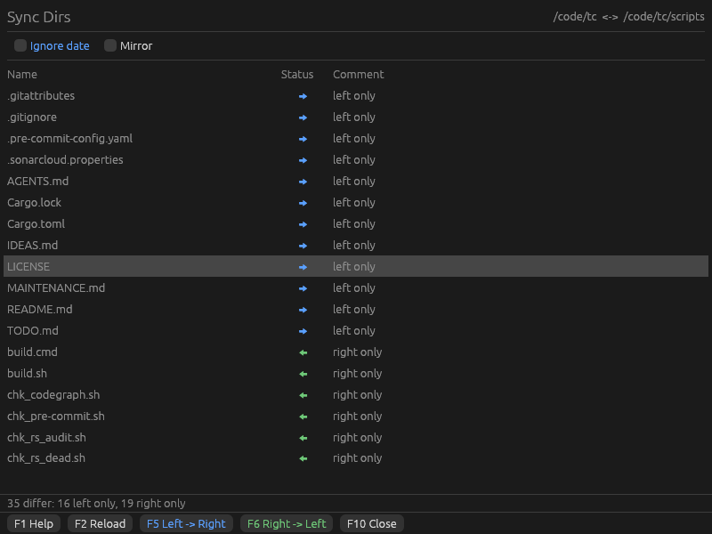
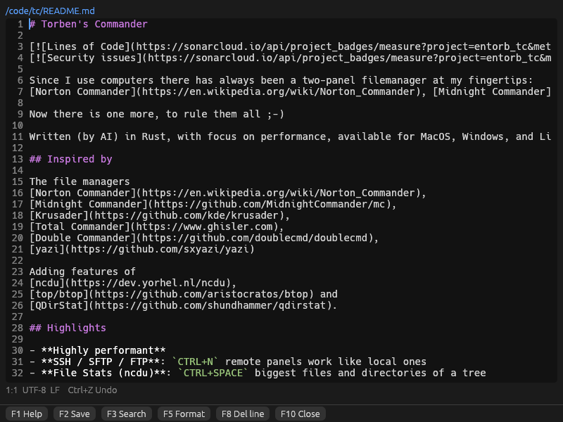

# Torben's Commander

[](https://sonarcloud.io/summary/overall?id=entorb_tc)
[](https://sonarcloud.io/summary/overall?id=entorb_tc)

Since I use computers there has always been a two-panel filemanager at my fingertips:
[Norton Commander](https://en.wikipedia.org/wiki/Norton_Commander), [Midnight Commander](https://github.com/MidnightCommander/mc), [Krusader](https://github.com/kde/krusader), [Total Commander](https://www.ghisler.com), ...

Now there is one more, to rule them all ;-)

Written (by AI) in Rust, with focus on performance, available for MacOS, Windows, and Linux, see [Releases](https://github.com/entorb/tc/releases)

## Inspired by

The file managers
[Norton Commander](https://en.wikipedia.org/wiki/Norton_Commander),
[Midnight Commander](https://github.com/MidnightCommander/mc),
[Krusader](https://github.com/kde/krusader),
[Total Commander](https://www.ghisler.com),
[Double Commander](https://github.com/doublecmd/doublecmd),
[yazi](https://github.com/sxyazi/yazi)

Adding features of
[ncdu](https://dev.yorhel.nl/ncdu),
[top/btop](https://github.com/aristocratos/btop) and
[QDirStat](https://github.com/shundhammer/qdirstat).

## Features

### Panels



- Norton Commander look, two panels with tabs
- SSH, SFTP, FTP via `CTRL+N`
- `LEFT` / `RIGHT` go to the parent or into the directory under the cursor
- Sort by name, extension, date, size
- Filter by `/`
- Quick search by typing
- Select by `SHIFT`, mouse, glob mask, or all `CTRL+A`
- History `CTRL+D`, bookmarks `CTRL+B`, popular directories `CTRL+Z`
- Sync browsing `CTRL+K`: enter same sub dir in different panels
- Compare panels `CTRL+Y`
- Multiple panel tabs
- Git-ignored entries shown dim (local only)
- Copy `F5`, move `F6`, delete `F8` run in a worker with progress and ETA, supports SSH
- Symlinks and hard links via in the `F9` menu

### File Stats (`ncdu`) `CTRL+SPACE`



- locate biggest files and directories
- table and cluster map
- local or via SSH

### Processes Manager (`top`) `CTRL+P`



- CPU, memory, load
- sort, filter, kill
- local or remote (SSH/SFTP)

### Multi-file rename `CTRL+M`



- masks, regex, counter, clean-up options
- `CTRL+Z` for undo

### Find files `CTRL+F`



- names or regex, content, size, date, `.gitignore`; options in tabs
- feed results as panel

### Synchronize directories `CTRL+E`



- lists the files that differ, at once; top level only (no subdirectories)
- one way: left -> right or right -> left, optionally mirrored (extras on the target deleted)
- local or remote; remote copies get the copy time, so compare by size there

### Command line

- `:` runs a command in the panel directory (local or via SSH)
- `F9` menu opens a terminal in it

### Archives

- `.zip`, `.tar`, `.tar.gz`, `.tar.bz2`, `.tar.xz`, `.gz`, `.bz2`, `.xz` open as directories in panel
- read-only

### Remote (SSH, SFTP, FTP, FTPS) `CTRL+N`

- Saved connections; passwords are asked on connect, never stored
- SFTP checks `~/.ssh/known_hosts`
- FTP anonymous by default
- FTPS explicit TLS
- Limits: no SMB, no reconnect, symlinks not created remotely, permissions and times not copied

### Viewer `F3` and Editor `F4`



- Viewer `F3`: stream supports huge files: search, go to line, hex view (`h`), encodings
- Editor `F4`: syntax colors for common languages, minor format on save

### Inline help `F1`

- lists all features and keys per tool

### Config

- Plain text in `$XDG_CONFIG_HOME/tc/` (`~/.config/tc/`, `%APPDATA%\tc\`)
- `F9` → Tools → Delete config files removes them.

### Planned Features

- SMB shares: the `smb` crate pins pre-release crypto crates that conflict with russh; add once they release against `curve25519-dalek` 5.0.0

## Build and run

Needs stable Rust (`rustup`, edition 2024). From the repo root:

```sh
scripts/build.sh/.cmd  # release binaries into target/release
scripts/run.sh/.cmd    # build and run
scripts/run_checks.sh  # same checks as CI
```

Opens in the current directory; extra arguments are passed on. On Linux `tc` needs X11 or Wayland with `libxkbcommon` and OpenGL.

Releases are zips, the binaries are not signed:

- macOS: `xattr -d com.apple.quarantine ./tc`
- Windows: SmartScreen **More info → Run anyway**, or `Unblock-File .\tc.exe`
